# 리모컨 관리자 웹

- 작업일: 2026-10-23
- 브랜치: `claude/trusting-wozniak-ghvzg2`
- 상태: 화면과 동작은 완성. **서버는 목업**이라 숫자는 가짜이고, 점검·정지 설정은 같은 브라우저의 웹 리모컨에만 반영된다(아래 "실서버 연동" 참고).

## 여는 방법

| 용도 | 명령 | 주소 |
|---|---|---|
| 개발 (리모컨과 함께) | `npm run dev` | `http://localhost:3000/admin/` (리모컨은 `/`) |
| 관리자 웹만 | `npm run dev:admin` | `http://localhost:3001/` |
| 배포 파일 | `npm run build:admin` | `dist-admin/` 정적 파일. 웹 서버 아무 경로에 올리면 된다 |

- CI가 `TOONA-admin-web` 아티팩트로 `dist-admin/`을 올린다.
- 설치형 패키지(`dist/`)에는 들어가지 않는다.

## 메뉴

### 사용자 관리

| 메뉴 | 내용 |
|---|---|
| **설치형 이용자 현황** | 누적 설치형 이용자, 기간 내 이용자(Windows/macOS), 지금 접속 중, 신규 설치. 설치형 일간 이용자 막대 차트(표로 보기 지원), 이용 환경별(설치형·PC 웹·모바일 웹)·OS별 이용자. 기간은 7/30/90일 |
| **버전 현황** | 최신 버전·이용률, 업데이트가 필요한 이용자, 지원 종료 버전 이용자. 버전별 이용자 표(상태 최신/지원/지원 종료, 배포일, Windows/macOS), [목록 보기]로 그 버전 회원 목록으로 이동 |
| **회원 관리** | 검색(전체·닉네임·투네이션 ID·이메일·회원 번호), 상태 탭(전체/정상/어뷰징 의심/정지 중), 이용 환경·버전 필터, 정렬. 행을 누르면 회원 상세 |
| **제재 내역** | 모든 이용 정지 기록(정지 중/기간 만료/해제), 회원 검색, 정지 중인 건 바로 해제 |

#### 회원 상세와 이용 정지 (어뷰징 대응)

- **상세 패널:** 기본 정보, 이용 환경, 설치형 버전과 첫 접속일, 최근 접속 기록 10건(환경·IP 앞 두 자리·분당 요청 수), 제재 이력. 분당 요청이 300회 이상이면 빨갛게 표시한다.
- **어뷰징 의심:** 서버가 잡은 신호(비정상 요청 반복, 변조된 클라이언트, 매크로, 비정상 다중 접속)가 있으면 패널 위에 주황 상자로 보여 준다. 목록의 "어뷰징 의심" 탭으로 모아 볼 수 있다.
- **[이용 정지]**
  - 입력: 사유(5종), 기간(1/3/7/30일·영구), 운영 메모(필수).
  - 오른쪽에 이용자가 보게 될 정지 화면을 미리 보여 준다.
  - 확인 창(빨간 [이용 정지])을 거친다.
  - 이미 정지 중이면 기존 정지는 "새 정지로 대체"로 해제되고 새 정지가 걸린다.
- **[정지 해제]:** 해제 사유를 필수로 남긴다.
- 이메일은 목록과 상세 모두 가려서 보여 준다(`tir*****@gmail.com`). 검색은 전체 주소로 된다.

### 점검

| 메뉴 | 내용 |
|---|---|
| **점검 일정** | 지금 상태(점검 중 + 남은 시간 / 다음 점검까지 / 없음), 점검 일정 등록·수정, 리모컨 점검 화면 미리 보기, 점검 기록 |

- **입력:**
  - 시작·종료 일시. [1시간][2시간][4시간]으로 종료를 빠르게 정한다.
  - 점검 대상: 설치형, PC 웹, 모바일 웹.
  - 안내 문구.
  - 점검 공지 링크(선택). 넣으면 점검 화면에 [점검 공지] 버튼이 생긴다.
  - 사전 예고: 예고 안 함, 30분, 1시간, 3시간, 24시간 전부터.
- **검사:**
  - 종료가 시작보다 앞서거나 이미 지난 일정은 막는다.
  - 대상이 없거나 문구가 비었을 때, 링크 형식이 틀렸을 때도 막는다.
  - 같은 대상에 시간이 겹치는 다른 일정이 있으면 막는다.
- **동작:**

| 버튼 | 결과 |
|---|---|
| [점검 예약] | 일정 저장. 시작 시각이 이미 지났으면 "바로 점검이 시작됩니다" 확인 창을 띄운다 |
| [지금 바로 시작] | 확인 창 후 지금부터 종료 일시까지 점검 |
| [지금 종료] | 진행 중인 점검을 조기 종료. 리모컨이 바로 돌아온다 |
| [종료 시간 변경] / [수정] | 진행 중·예정 일정 수정 |
| [예약 취소] | 시작 전 일정 취소 |

## 리모컨에서 바뀌는 것

| 관리자 웹 설정 | 리모컨 |
|---|---|
| 점검 시간 중 (대상 환경) | 어느 화면에 있든 **점검 화면**(p34)으로 바뀐다. 점검 시간·안내 문구·[점검 공지]·[새로 고침]이 나온다. 점검이 끝나면(또는 조기 종료하면) 자동으로 원래대로 돌아간다 |
| 점검 예고 시간 안 | 상단 공지 바가 `[점검 예정] 2026.10.24 (토) 02:00 ~ 06:00 리모컨 점검`으로 바뀐다. 공지 링크가 있으면 누르면 열린다 |
| 이용 정지 | 로그인하거나 사용 중일 때 **이용 정지 화면**으로 바뀐다. 사유·기간·[고객센터 문의]·[로그아웃]이 나온다. 해제하면 자동으로 돌아간다 |

- 점검 화면과 정지 화면은 리모컨과 관리자 웹 미리 보기가 같은 컴포넌트(`src/components/StatusScreens.tsx`)를 쓴다. 미리 보기가 실제 화면과 같다.
- 목업에서 리모컨 로그인 회원은 `피곤한고양이`(회원 번호 `M100001`, 회원 목록에 있다)다. 이 회원을 정지하면 같은 브라우저의 웹 리모컨이 막힌다.

## 화면

| | |
|---|---|
| 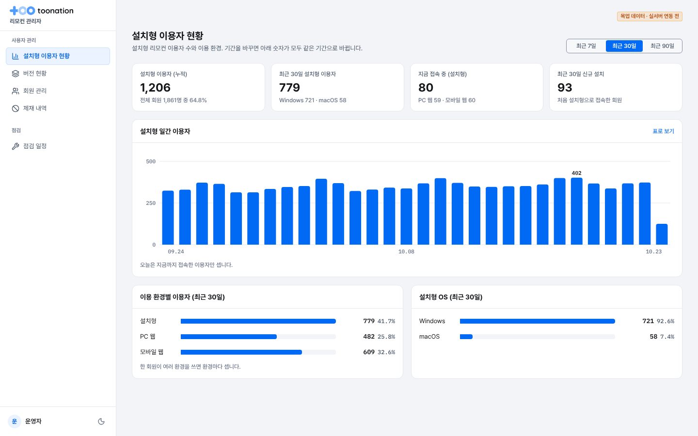 | 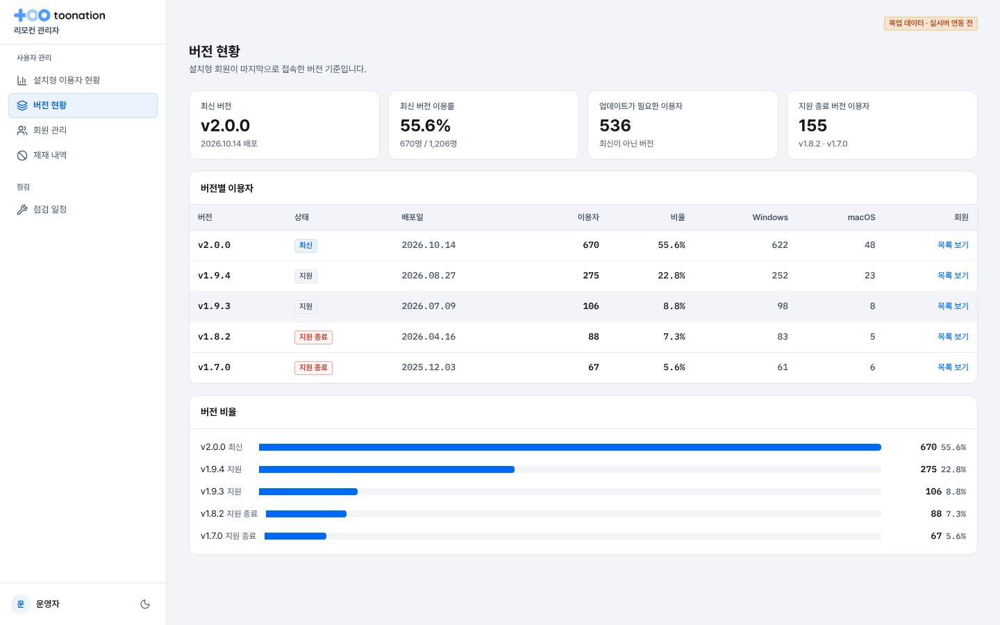 |
| 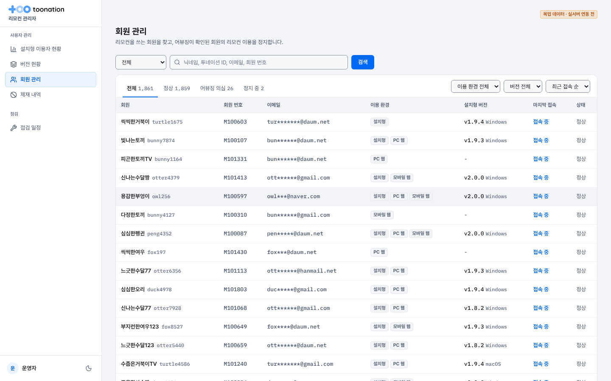 | 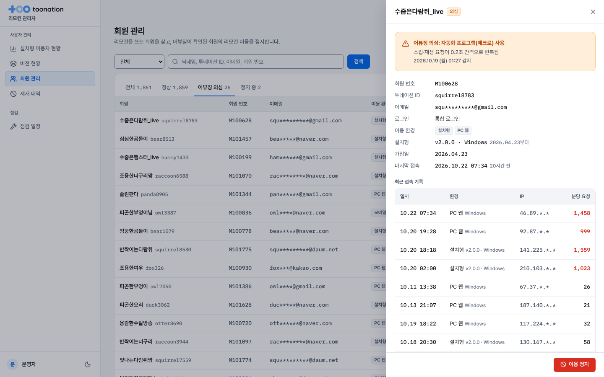 |
| 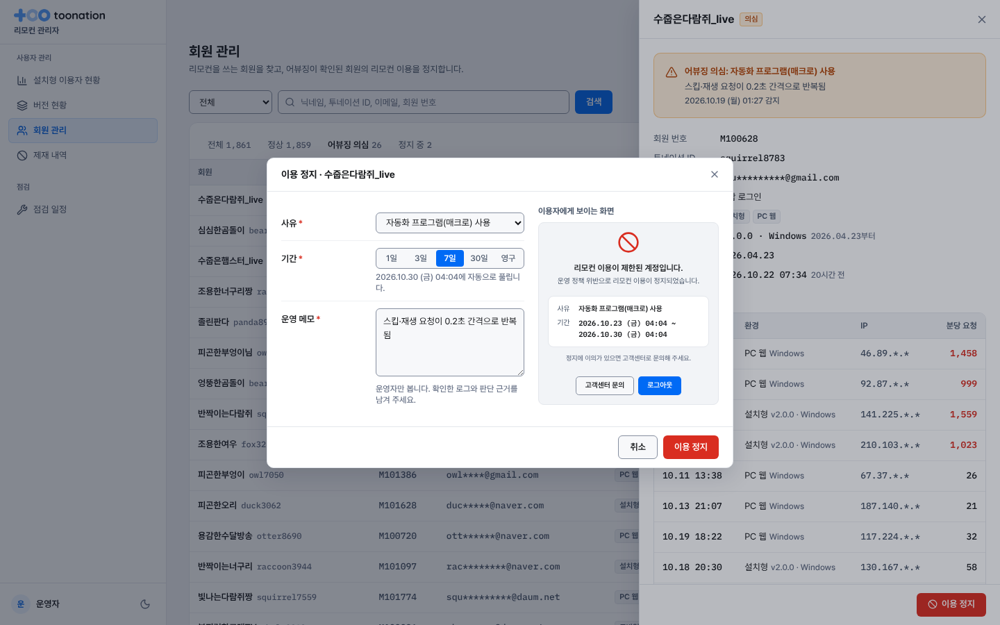 | 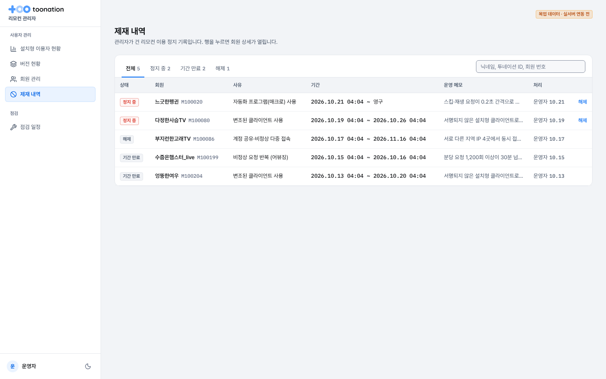 |
| 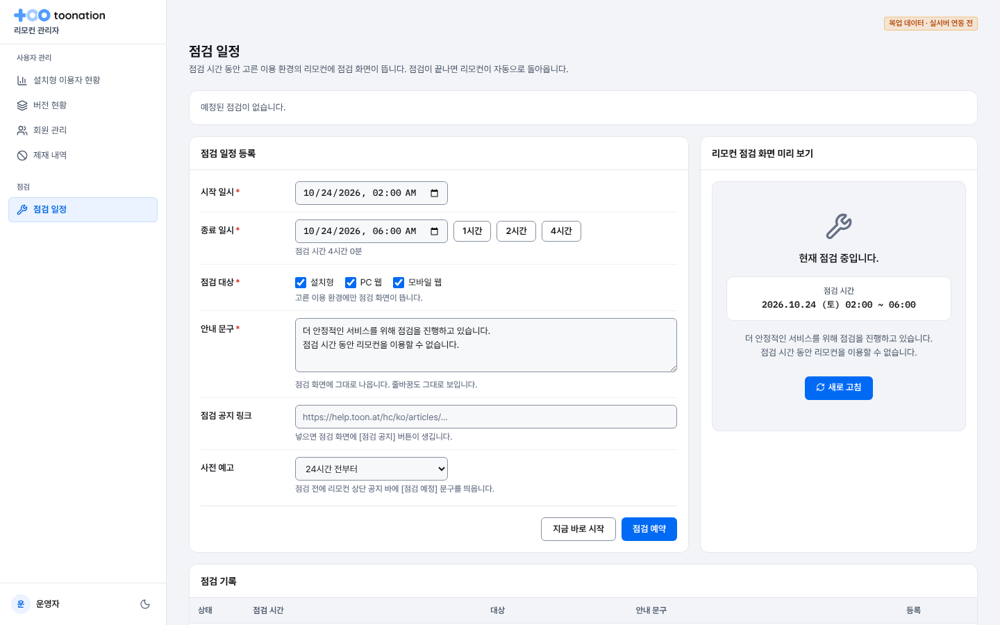 | 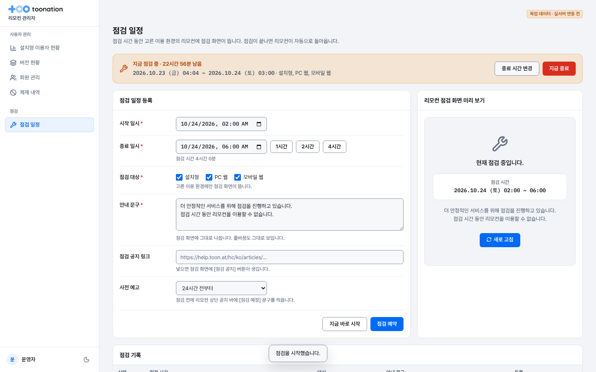 |
| 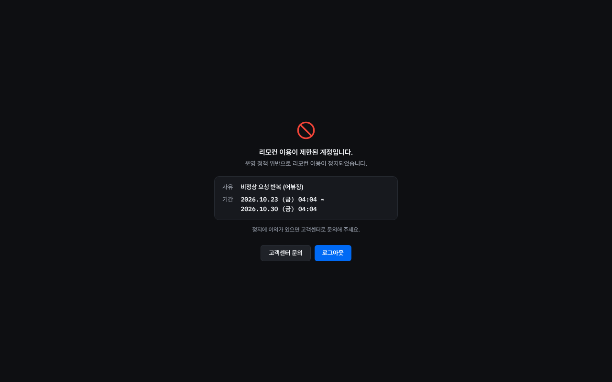 | 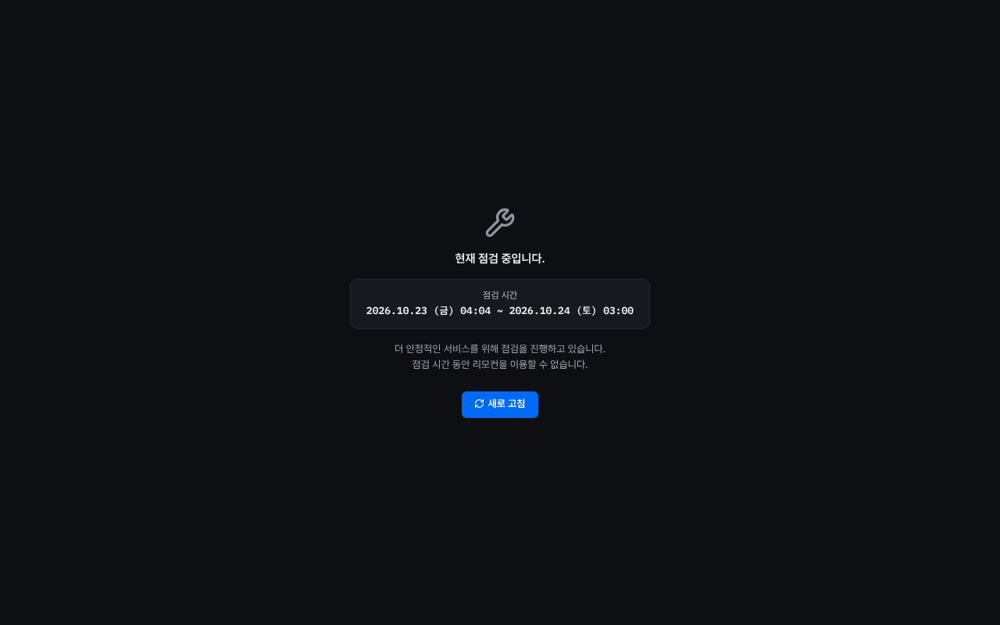 |
| 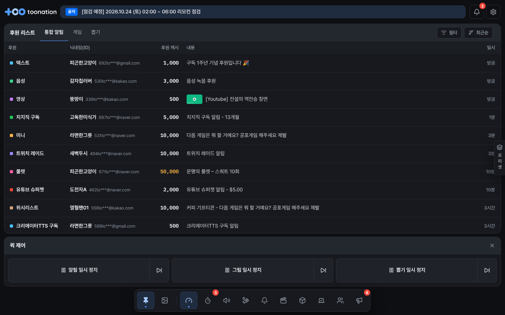 | 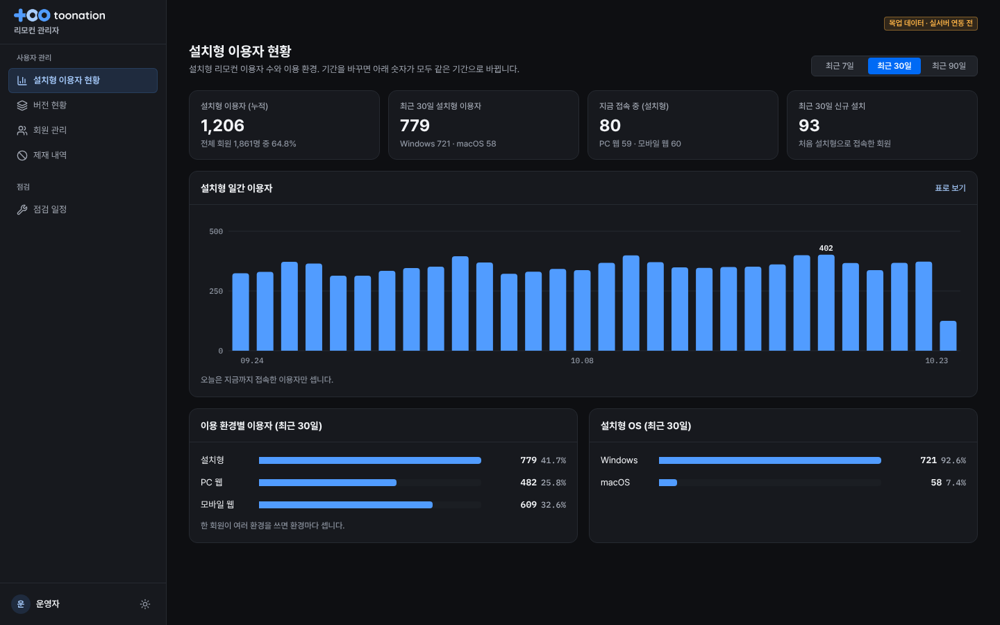 |

## 디자인

- 리모컨과 같은 디자인 토큰(`toona-design-tokens.md`)과 버튼·입력칸·토글을 쓴다.
  - 공용 컨트롤은 `src/components/primitives.tsx`로 분리했다. 관리자 웹은 리모컨 상태 코드를 불러오지 않는다.
- 관리자 웹은 표를 오래 보는 화면이라 **라이트가 기본**이다. 왼쪽 아래 버튼으로 다크로 바꿀 수 있고, 고른 값은 브라우저에 저장된다.
- 상태 표시는 색과 글자를 함께 쓴다(정지 중·의심·최신·지원 종료 등). 작은 글자의 대비는 4.5:1 이상이다.
  - 라이트에서는 파란 상태 글자를 `brand-hover`로 한 단계 진하게 썼다.
  - 빨간 상태의 바탕은 4%로 옅게 했다.
- 차트는 한 가지 값만 보여 줘서 색을 `live` 하나만 쓴다. 막대에 올리면 날짜와 값이 뜨고, 같은 값을 [표로 보기]로도 볼 수 있다.
- 768px 이하에서는 왼쪽 메뉴가 위쪽 가로 메뉴로 바뀐다(`screens/members-mobile.png`).

## 실서버 연동 시 할 일

1. `src/api/admin.ts`의 `AdminBackend`를 실서버 API로 구현하고, `src/admin/backend.ts`의 한 줄만 바꾼다.
2. 리모컨은 `src/api/server.ts`의 `Maintenance`, `Sanction` 모양으로 점검·정지 정보를 받는다.
   - 접속할 때 한 번 받는다.
   - 사용 중에는 주기적으로 받거나 소켓으로 푸시받는다.
   - 지금 목업 백엔드(`src/api/mock.ts`)의 `watchServer()`가 15초마다 확인한다. 이 부분을 서버 호출로 바꾼다.
3. 설치형은 지금 관리자 웹 설정을 받지 못한다. 저장소(localStorage)가 브라우저와 따로라서 그렇다. 2번이 되면 설치형도 같이 반영된다.
4. 관리자 로그인과 권한이 필요하다. 지금은 로그인 없이 "운영자"로 기록한다. 사내 관리자 계정 연동 방식이 정해지면 붙인다.
5. 정지는 서버에서도 막아야 한다. 화면만 막으면 변조된 클라이언트는 그대로 쓸 수 있다. 정지된 계정의 리모컨 API·소켓 요청은 서버가 거절해야 한다.

## 검증

- `npm run typecheck`, `npm test`(89개) 통과. 점검·정지 규칙 테스트 10개를 새로 추가했다(`src/api/server.test.ts`).
- 브라우저 E2E(관리자 웹과 웹 리모컨을 같은 브라우저에서 띄움):
  1. 리모컨 사용 중 `M100001` 이용 정지 → 리모컨이 정지 화면으로 바뀜. 해제 → 리모컨 화면 복귀
  2. [지금 바로 시작] → 리모컨이 점검 화면으로 바뀜. [지금 종료] → 리모컨 복귀
  3. 내일 02:00 점검 예약(24시간 전 예고) → 리모컨 공지 바에 `[점검 예정] …` 표시
  4. 회원 패널 위 정지 창에서 Esc → 정지 창만 닫히고 패널은 남음
  5. 390px 폭에서 가로 스크롤 없음
  6. 콘솔 오류 없음
