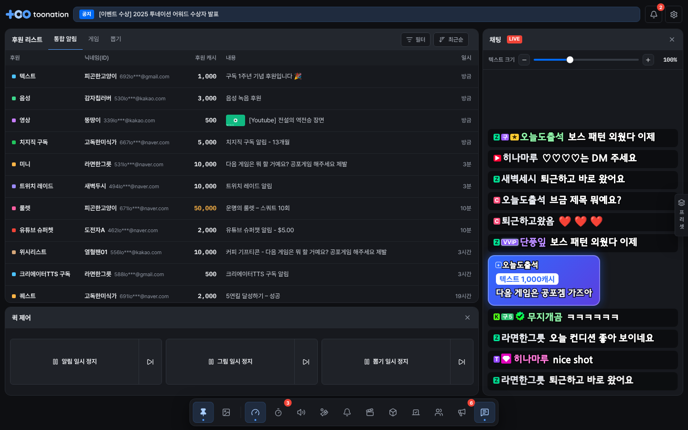
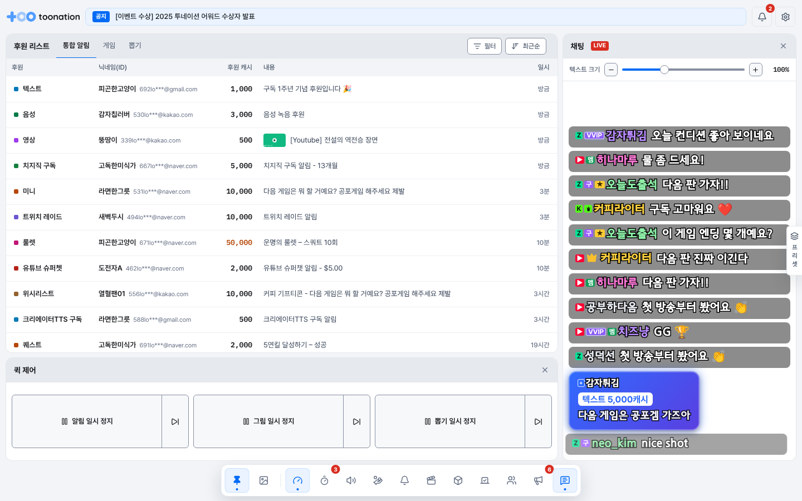
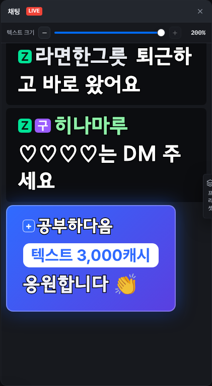
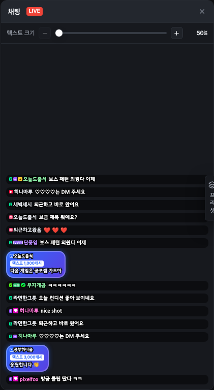
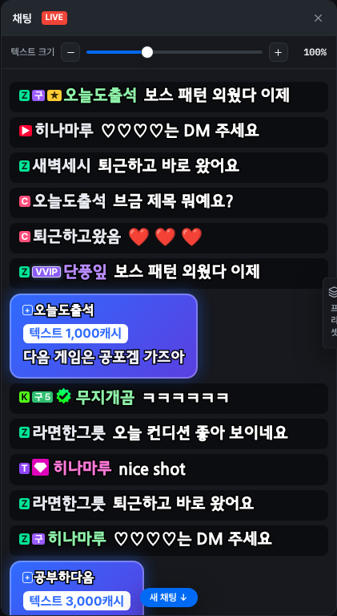
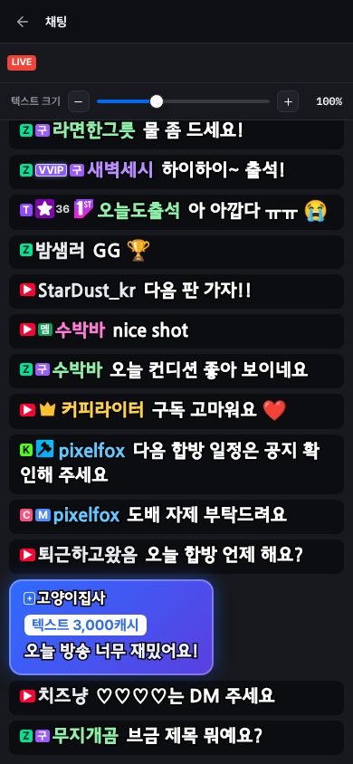
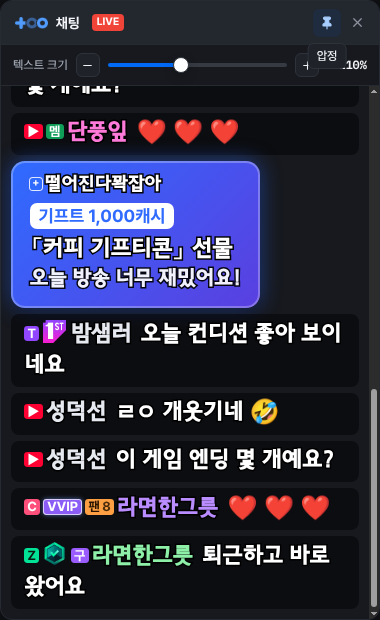

# 채팅 위젯 (모니터링)

- 작업일: 2026-11-25 · 버전 2.0.1
- 원본: caprisontoon/total `public/chat-widget-app.html` (채팅 위젯 프로토타입, main `3fe650d`)의 '리모컨 채팅 위젯'
- 요청: '채팅 위젯 페이지 구성' 세션에서 전달 (사용자 요청)

## 결정 사항

| # | 질문 | 결정 |
|---|---|---|
| 1 | 크리에이터 채팅 위젯 설정을 어디서 가져올지 | **기본값 고정.** 프로토타입 기본값 그대로 (기본 박스 테마, 제주고딕 20px 굵게, 외곽선 3px, 배지·후원 카드·필터 기본) |
| 2 | 텍스트 크기 저장 위치 | **기기별.** 리모컨 설정(이 PC·브라우저)에 저장, 독립창과 공유 |
| 3 | 채팅 배경 | **위젯 바탕색.** 프로토타입의 투명 체크무늬 대신 리모컨 위젯 바탕(다크·라이트) |
| 4 | 폰트 | **제주고딕만 앱에 포함** (woff2 353KB, SIL OFL 1.1). 인터넷 없이도 같게 보인다 |

## 동작 (프로토타입 그대로)

- 채팅 한 줄은 프로토타입과 **같은 HTML·CSS**로 그린다.
  - 플랫폼 배지, 역할 배지(공식 이미지), 투네이션 등급, 이모트, 후원 카드(강조·VIP/VVIP/SVIP)가 모두 같다.
- 채팅 필터: 봇 숨김, 금칙어 ♡ 표시.
- 모니터링 예외:
  - '최대 표시 줄', '자동으로 감추기', '위쪽 흐리게'는 적용하지 않는다.
  - 최근 **150개**를 스크롤해서 본다.
- 스크롤:
  - 맨 아래를 보고 있으면 새 채팅에 맞춰 자동으로 내려간다.
  - 위로 올려 보는 중에는 멈추고 **[새 채팅 ↓]**를 띄운다. 누르면 맨 아래로 간다.
  - 텍스트 크기나 위젯 크기가 바뀌어도 맨 아래를 유지한다.
- **텍스트 크기**: 50~200%, 10% 단위, 기본 100%. [−] [+]와 슬라이더로 바꾸고, 폰트 크기에 곱해서 적용한다.

## 리모컨에 맞게 바꾼 것

| 프로토타입 | 리모컨 |
|---|---|
| 자체 헤더(채팅 · LIVE · 창 분리 · 닫기) | 기존 위젯 틀: 제목 '채팅' + LIVE, 닫기. 설치형은 압정 |
| 창 분리 = 브라우저 새 창(Document PiP·팝업) | **설치형**: 다른 위젯처럼 제목줄을 캔버스 밖으로 끌어내 독립창으로 분리하고, 압정으로 항상 위에 둔다. **웹**: 기존 정책대로 분리 없음 (p6) |
| 자체 Dock 채팅 버튼 | 리모컨 Dock 맨 끝 채팅 아이콘으로 켜고 끈다. 모바일은 [리모컨 위젯] 목록 맨 끝 |
| 목업 채팅 생성기 (페이지 안) | 같은 생성기(초당 약 1.2개)를 리모컨 목업 서버에 넣어, 메인 창과 독립창이 같은 채팅을 본다. 최근 300개 보관(필터로 숨길 채팅 포함) |

## 코드 위치

- `src/chat/engine.ts`: 플랫폼·배지·후원 종류·기본 설정, 목업 생성기, 필터, 한 줄 그리기
- `src/chat/badgeImages.ts`: 공식 배지 이미지 24개
- `src/chat/chatWidget.css`: 원본 표시 CSS(설정 화면 전용 규칙만 뺌) + 리모컨 목록·폰트
- `src/widgets/Chat.tsx`: 위젯
- `src/assets/fonts/JejuGothic-Regular.woff2`: 폰트와 라이선스(`OFL-JejuGothic.txt`)
- 테스트: `src/chat/engine.test.ts` (필터·이스케이프·배지·후원 카드·텍스트 크기)

## 실서버 연동 시

1. 채팅: 목업 서버의 `startChat()`을 실제 채팅 수신으로 바꾼다. 메시지 모양은 `ChatMsg`를 따른다.
2. 설정: `CHAT_SETTINGS`를 크리에이터 채팅 위젯 설정 값으로 바꾼다. 필드 이름은 프로토타입 설정과 같다.

## 화면

| | |
|---|---|
|  |  |
|  |  |
|  |  |
|  | |

## 검증

- `npm run typecheck`, `npm test` 110개 통과 (채팅 엔진 7개 추가), `npm run build` 통과
- 브라우저(웹, 1440px·390px):
  - 제주고딕 로드, 봇 숨김
  - 텍스트 크기 120% → 폰트 24px. 200%·50%에서 버튼이 비활성화된다
  - 위로 스크롤하면 [새 채팅 ↓]가 뜨고 위치가 멈춘다. 누르면 맨 아래로 간다
  - 목록은 150개 이하로 유지된다
  - 닫기 → Dock 꺼짐 → Dock으로 다시 켜기
  - 모바일 위젯 화면
  - 콘솔 오류 없음
- 설치형(Electron):
  - 독립창으로 분리하면 같은 채팅이 보인다
  - 독립창에서 텍스트 크기를 바꿀 수 있다
  - 압정 → 항상 위
  - 닫기 → 창이 닫힌다
  - 오류 없음
