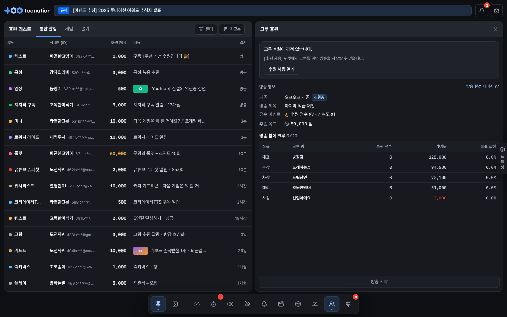
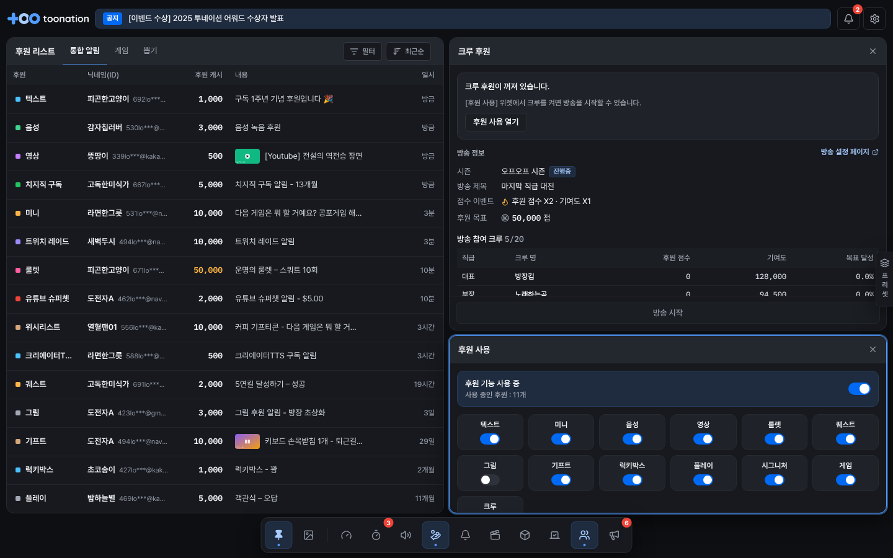
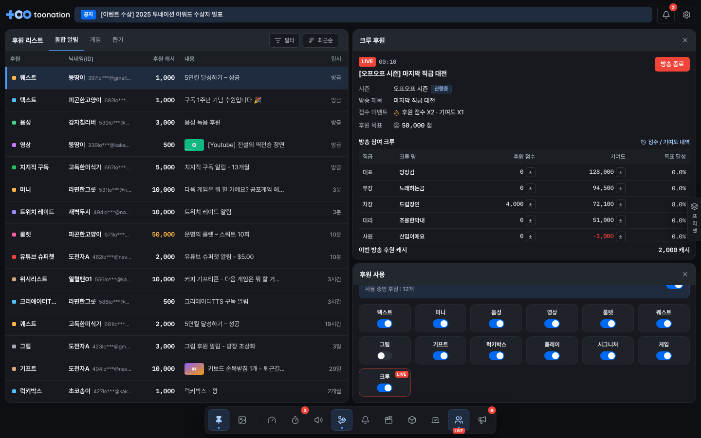
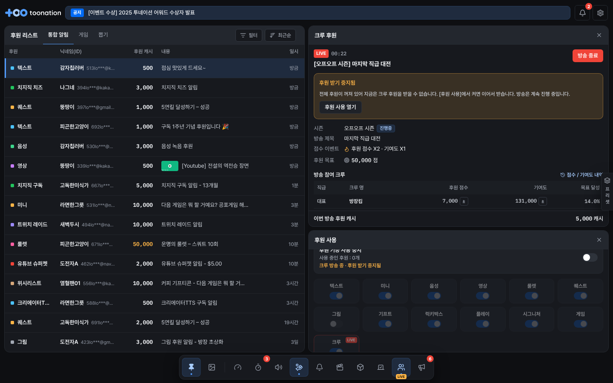
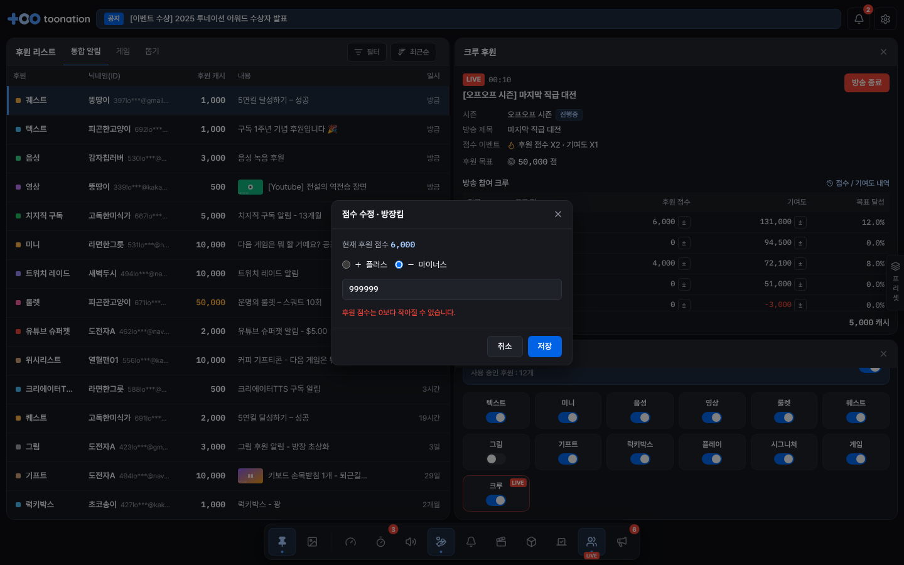
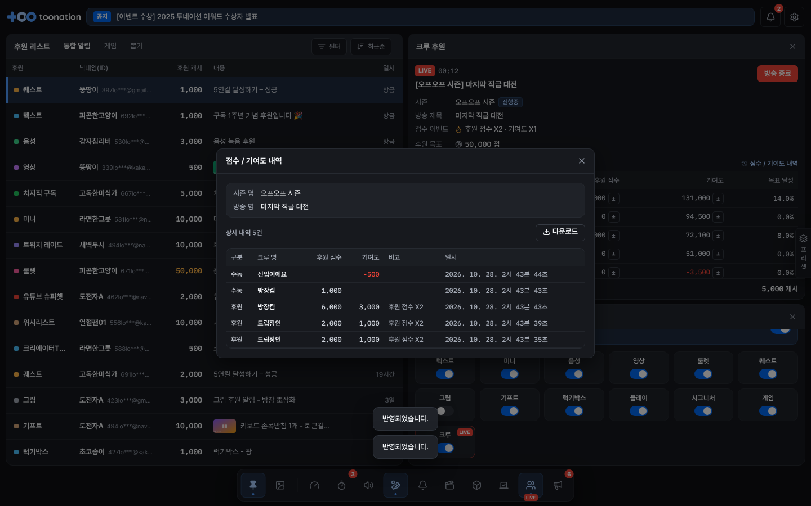
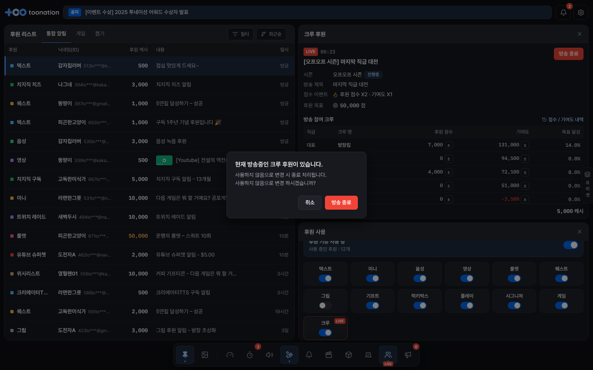
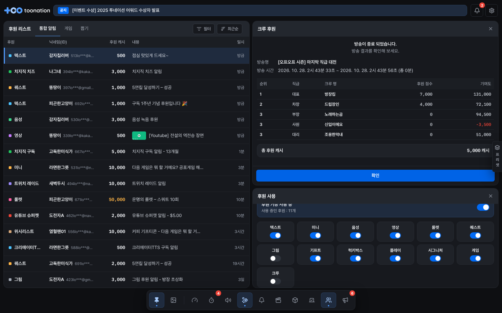
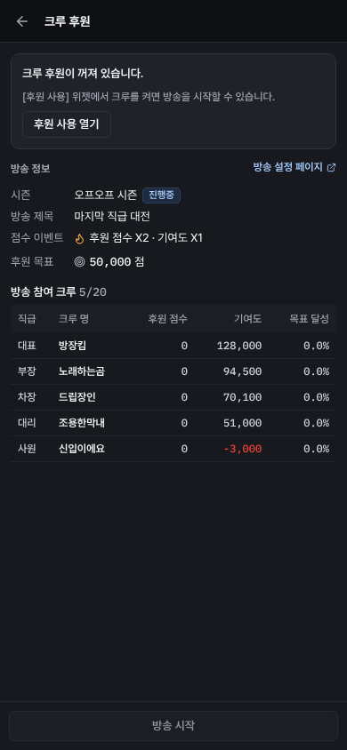
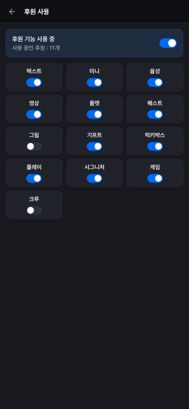

# [후원 사용] ↔ [크루 후원] 위젯 연동

- 작업일: 2026-10-28
- 기준:
  - 크루 후원 1차 상세기획 v0.1.4
  - 크루 후원 1.5차 상세기획 v0.3
  - 리모컨 개편 상세기획 v0.21 (p69~70, p79~80)
- 범위: 리모컨 안의 두 위젯이 함께 움직이는 동작. **크리에이터 페이지 연동은 이번 범위가 아니다.** 시즌, 방송 제목, 참여 크루, 점수 이벤트, 후원 목표는 크리에이터 페이지에서 정한 값을 받아 보여 주기만 한다.

## 결정 사항

| # | 질문 | 결정 |
|---|---|---|
| 1 | 크루 방송 중 [후원 사용] **전체 OFF** | **방송 유지.** 그동안 크루 후원도 받지 않고, 크루 위젯과 Dock에 "후원 받기 중지됨"을 표시한다 |
| 2 | 크루 OFF 상태에서 [방송 시작] | **막는다.** 크루 위젯이 대신 켜지 않고 [후원 사용 열기]로 안내한다 |
| 3 | 수동 수정·내역·이벤트·목표 (1.5차, 수정사항 표 기준 V2.5) | **이번에 넣는다** |

## 동작 규칙

규칙은 `src/lib/crew.ts` 한 곳에 있고, 두 위젯과 목업 서버가 같은 함수를 쓴다(테스트 `src/lib/crew.test.ts` 14개).

| 하는 일 | 조건 | 결과 |
|---|---|---|
| [후원 사용] 크루 OFF | 방송 중 아님 | 바로 OFF. 크루 위젯은 "크루 후원이 꺼져 있습니다" + [후원 사용 열기], [방송 시작] 비활성 |
| [후원 사용] 크루 OFF | **방송 중** | 확인 창(1차 p7 문구): "현재 방송중인 크루 후원이 있습니다. 사용하지 않음으로 변경 시 종료 처리됩니다." → 빨간 [방송 종료]를 누르면 OFF + 방송 종료 → 크루 위젯이 결과 화면으로 바뀜 |
| [후원 사용] 크루 ON | – | ON만 된다(방송 자동 시작 없음). 토스트: "[크루 후원] 위젯에서 방송을 시작할 수 있습니다." |
| [후원 사용] 전체 OFF | **방송 중** | 확인 창: "크루 방송은 종료되지 않고 계속 진행됩니다. 다만 다시 켤 때까지 크루 후원도 받을 수 없습니다." → [후원 기능 끄기] |
| 〃 다시 ON | 방송 중 | "후원 받기 중지됨" 표시가 사라지고 후원을 다시 받음 |
| [크루 후원] 방송 시작 | 크루 ON, 시즌 있음·진행중, 제목 있음, 참여 크루 1~20명 | 확인 창을 거쳐 시작. 후원 점수는 0부터, 기여도(시즌 누적)는 이어짐 |
| 〃 | 위 조건 중 하나라도 빠짐 | 버튼 비활성 + 이유 표시. 크루 OFF는 [후원 사용 열기]로 안내 |
| 〃 | 전체 후원 OFF | 시작은 됨. 확인 창에 "지금은 크루 후원을 받을 수 없습니다"를 함께 보여 줌 |
| [크루 후원] 방송 종료 | 방송 중 | 빨간 확인 버튼을 거쳐 종료하고 결과 화면. **크루 사용은 ON 그대로** |

- [후원 사용 열기]를 누르면 다음처럼 동작한다:
  - 캔버스에 [후원 사용] 위젯이 있으면 테두리를 1.6초 강조한다.
  - 없으면 Dock에서 추가할 때처럼 캔버스에 띄운다.
  - 모바일 웹은 [후원 사용] 화면으로 이동한다.
- 목업 서버도 같은 규칙을 지킨다. 화면을 거치지 않은 요청도 그대로 따른다:
  - 크루를 끄면 방송이 종료된다.
  - 시작 조건이 모자라면 오류 토스트를 띄우고 시작하지 않는다.
  - 전체 후원이나 크루가 꺼져 있으면 크루 후원이 들어오지 않는다.

## 화면

### [후원 사용]
- 방송 중에는 [크루] 칸에 빨간 LIVE 표시와 테두리가 붙는다. 마우스를 올리면 "끄면 방송이 종료됩니다"가 뜬다.
  - 칸 위치는 고정이다. 후원 페이지 탭 순서(1.5차 정책 1)를 따라 옮기지 않는다.
- 전체 OFF + 방송 중이면 상단에 "크루 방송 중 · 후원 받기 중지됨"을 표시한다.

### [크루 후원]

| 상태 | 화면 |
|---|---|
| 준비 | 방송 정보(시즌 + 진행중/종료, 방송 제목, 점수 이벤트, 후원 목표), 방송 참여 크루(n/20), [방송 시작] |
| 방송 중 | LIVE + 경과 시간, [시즌] 제목, [방송 종료]. 전체 OFF면 주황 "후원 받기 중지됨" 상자. 참여 크루 표(직급, 크루 명, 후원 점수 ±, 기여도 ±, 목표 달성), [점수 / 기여도 내역], 이번 방송 후원 캐시 |
| 결과 | 방송명, 방송 시간, 순위(같은 점수는 같은 순위·이름순, 다음 순위는 건너뜀), 총 후원 캐시, [확인] → 준비 |

- **기여도는 점수로 표시한다.** 마이너스면 빨간색이다. 이전 화면의 % 표시는 고쳤다.
- **수동 수정 (1.5차 p5):**
  - [±]를 누르면 점수 수정 또는 기여도 수정 창이 열린다.
  - 플러스/마이너스를 고르고 1 ~ 1,000,000 사이 정수를 입력한다. 점수 이벤트 배수는 적용하지 않는다.
  - 저장하면 "반영되었습니다." 토스트가 뜬다.
  - 후원 점수는 0 아래로 내려가지 않는다("후원 점수는 0보다 작아질 수 없습니다."). 기여도는 마이너스가 될 수 있다.
- **점수 / 기여도 내역 (1.5차 p6):**
  - 시즌 명과 방송 명을 보여 준다.
  - 표 열: 구분(후원/수동), 크루 명, 후원 점수, 기여도, 비고(예: 후원 점수 X2), 일시. 마이너스는 빨간색이다.
  - 10건씩 페이지로 나눠 보여 준다.
  - [다운로드]는 `점수기여도_전체내역.csv`로 받는다. 엑셀에서 바로 열리고(BOM 포함), 맨 위에 시즌 명과 방송 명이 들어간다.
- **점수 계산:**
  - 후원 1건마다 계산한다: 캐시 ÷ 시즌 비율(N 캐시당 M 점) × 이벤트 배수 → 시즌 반올림 기준(올림/반올림/버림).
  - 마이너스 후원은 후원 점수는 그대로 두고 기여도만 깎는다(1차 p3).
- **목표 달성:** 후원 목표가 켜져 있으면 "후원 점수 ÷ 목표"를 소수점 1자리로 보여 준다. 100% 이상이면 강조한다.

### Dock
- 방송 중이면 크루 아이콘 아래에 LIVE를 붙인다. 평소에는 빨강이고, 전체 후원 OFF면 주황이다.
- 툴팁은 "크루 후원 · 방송 중 12:34 · 후원 받기 중지됨" 형식이다.

| | |
|---|---|
|  |  |
|  |  |
|  |  |
|  |  |
|  |  |

## 기획서와 다르게 정했거나 확인이 필요한 곳

1. **후원 점수 마이너스 한도:** 기획서에 없어서 0 아래로 내려가지 않게 막았다. 기여도는 기획서대로 마이너스를 허용한다.
2. **수동 수정은 방송 중에만 된다.** 1.5차 p8은 방송 생성 화면에도 ±가 있다. 하지만 리모컨에서는 방송 중 조정만 넣었다. 방송 전 기여도 조정은 크리에이터 페이지 몫으로 봤다.
3. **크루 OFF 확인 문구:** 1차 p40(리모컨)과 p7(크리에이터 페이지) 문구가 다르다. 뜻이 더 분명한 p7 문구를 쓰고, 버튼은 [방송 종료]로 했다.
4. **수정사항 표의 버전:** 1.5차 수정사항 표에는 수동 수정, 점수 이벤트, 목표가 **V2.5**로 적혀 있다. 결정 3에 따라 이번에 넣었다.

## 검증

- `npm run typecheck`, `npm test` 103개 통과(크루 규칙 14개 추가).
- 브라우저 E2E(1440px + 모바일 390px), 콘솔 오류 없음:
  1. 크루 OFF → [방송 시작] 비활성. [후원 사용 열기]를 누르면 위젯이 없을 때는 캔버스에 띄우고, 있을 때는 테두리를 강조한다.
  2. 크루 ON → 시작 → 위젯과 Dock에 LIVE. 모의 후원으로 점수가 오르고 이벤트 배수가 적용된다.
  3. 수동 수정: 범위 밖 입력과 점수 0 미만은 오류로 막는다. 정상 입력은 반영되고 내역에 "수동"으로 기록된다. CSV를 내려받는다.
  4. 전체 OFF → 확인 → 방송 유지 + 주황 상자, 9초 동안 크루 후원이 들어오지 않는다. 다시 ON → 상자가 사라진다.
  5. 방송 중 크루 OFF → 확인 → 방송 종료와 결과 화면. 크루 토글 OFF.
  6. 모바일: 크루 화면의 [후원 사용 열기] → 후원 사용 화면으로 이동한다.
- 참고: 테스트 컨테이너는 UTF-8 로케일이 없어서 CSV 이름이 "download"로 받아졌다. `LANG=C.UTF-8`에서는 `점수기여도_전체내역.csv`로 정상 저장되는 것을 확인했다.
