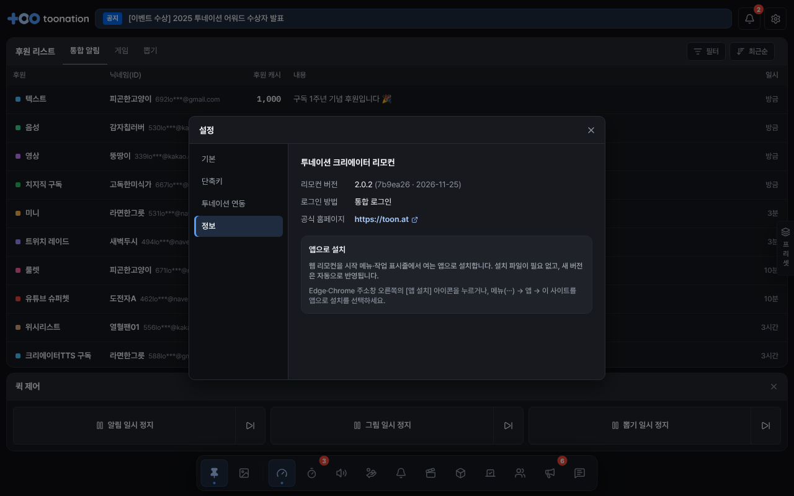

# 웹앱(PWA)으로 설치 — 서명 없이 PC에 설치하기

설치형(.exe)은 코드 서명이 없어서 **스마트 앱 컨트롤이 켜진 PC에서는 설치되지 않는다.**
스마트 앱 컨트롤은 서명되지 않았고 Microsoft가 모르는 실행 파일을 예외 없이 막는다.
대신 웹 리모컨을 **Edge·Chrome의 "앱으로 설치"(PWA)**로 설치하면 다음처럼 쓸 수 있다.

- 실행 파일이 없다. 실행하는 것은 이미 서명된 브라우저라서 스마트 앱 컨트롤과 상관없다.
- 시작 메뉴·작업 표시줄에 'TOONA 리모컨' 아이콘이 생기고, 주소창 없는 별도 창으로 열린다.
- 새 버전을 배포하면 다음에 열 때 자동으로 반영된다. 업데이트를 묻지 않는다.
- 인터넷이 잠깐 끊겨도 마지막으로 열었던 화면은 열린다(서비스 워커 저장본).

## 설치 방법 (Edge 기준, Chrome도 같다)

1. https://caprisontoon.github.io/remote01/ 를 연다.
2. 주소창 오른쪽의 **[앱 설치]** 아이콘을 누른다.
   - 또는 리모컨 **설정 → 정보 → [앱으로 설치]**를 누른다.
   - 또는 브라우저 메뉴(⋯) → **앱 → 이 사이트를 앱으로 설치**를 고른다.
3. [설치]를 누르면 별도 창으로 열린다. 작업 표시줄에 고정해 두면 편하다.

제거는 앱 창 오른쪽 위 메뉴(⋯) → 제거, 또는 Windows 설정 → 앱에서 한다.

## 설치형(.exe)과 다른 점

| 기능 | 설치형 | 웹앱 |
|---|---|---|
| 위젯·레이아웃·프리셋·후원 리스트·채팅 등 리모컨 기능 | ○ | ○ |
| 위젯 창 분리 | ○ (끌어내기) | ○ (끌어내기 또는 제목줄 [창 분리], 브라우저 팝업 창) |
| 자석 (창끼리 붙기) | ○ | – |
| 압정(항상 위) | ○ | – |
| 전역 단축키 (다른 프로그램을 보고 있을 때) | ○ | – |
| 투네이션 알림창 실시간 연동 (설정 > 투네이션 연동) | ○ | – |
| 업데이트 | 실행 시 확인 후 [업데이트] | 자동 (다음에 열 때) |
| 스마트 앱 컨트롤이 켜진 PC | 설치 안 됨 (서명 필요) | ○ |

## 위젯 창 분리 (웹·웹앱)

- 분리하는 방법은 둘이다.
  - 위젯 제목줄을 브라우저 창 밖으로 끌어낸다.
  - 제목줄의 **[창 분리]**(↗) 버튼을 누른다. 위젯이 있던 자리 근처에 같은 크기로 창이 열린다.
- 웹앱으로 설치해 쓰면 분리한 창도 별도 앱 창으로 뜬다.
- 분리한 창의 제목줄 버튼:
  - **[메인 창으로 되돌리기]**(↶): 창을 닫고 메인 화면에서 놓을 자리를 고른다. Dock에서 위젯을 추가할 때와 같다.
  - **[닫기]**(×): 위젯을 끈다. 창을 직접 닫아도 같다.
- Dock에서 끄면 분리한 창도 닫힌다.
- 메인 창을 닫으면 분리한 창도 닫힌다. 분리한 창은 메인 창에서 상태를 받아 동작하기 때문이다.
- 브라우저가 팝업을 막으면 주소창의 팝업 차단 아이콘에서 이 사이트를 허용한다.
- 웹에서는 창을 항상 위에 둘 수 없어서 압정은 없다. 후원 리스트는 설치형과 같이 분리할 수 없다.
- 코드: `src/shell/webWindows.ts`

## 구성

- `public/manifest.webmanifest`
  - 앱 이름, 시작 주소, 창 모드(standalone)를 정한다.
  - 아이콘은 `public/icons/`에 있고 투네이션 심볼로 만들었다.
- `public/sw.js`: 서비스 워커
  - 페이지는 네트워크를 먼저 쓰고, 안 되면 저장본을 쓴다(새 배포가 바로 반영된다).
  - 해시가 붙은 파일(JS·CSS·폰트)은 저장본을 먼저 쓴다.
- `src/lib/pwa.ts`
  - 서비스 워커를 등록한다(https 배포본에서만, 설치형·개발 서버는 제외).
  - 브라우저의 설치 가능 알림을 받아 [앱으로 설치] 버튼에 연결한다.
- 설정 > 정보: [앱으로 설치] 버튼(웹에서만). 이미 설치한 앱으로 열었으면 "설치된 앱으로 실행 중"을 표시한다.

## 검증

- Chromium 개발자 도구 기준 설치 가능 조건 오류 없음 (`Page.getInstallabilityErrors` = []), 매니페스트 오류 없음
- 서비스 워커 활성화 확인. 오프라인으로 바꾸고 다시 열어도 리모컨이 열린다.
- GitHub Pages와 같은 하위 경로(`/remote01/`)에서 확인했다.
- 실제 Edge 설치 창은 이 환경에서 띄울 수 없어 직접 확인하지 못했다.

## 참고

- 회사 PC 정책으로 브라우저의 앱 설치가 막혀 있으면 이 방법도 쓸 수 없다. 그 경우 웹 리모컨을 브라우저 탭으로 쓴다.
- 압정·전역 단축키·독립창이 꼭 필요하면 설치형에 서명이 필요하다(`docs/desktop/자동업데이트.md`의 '주의').
