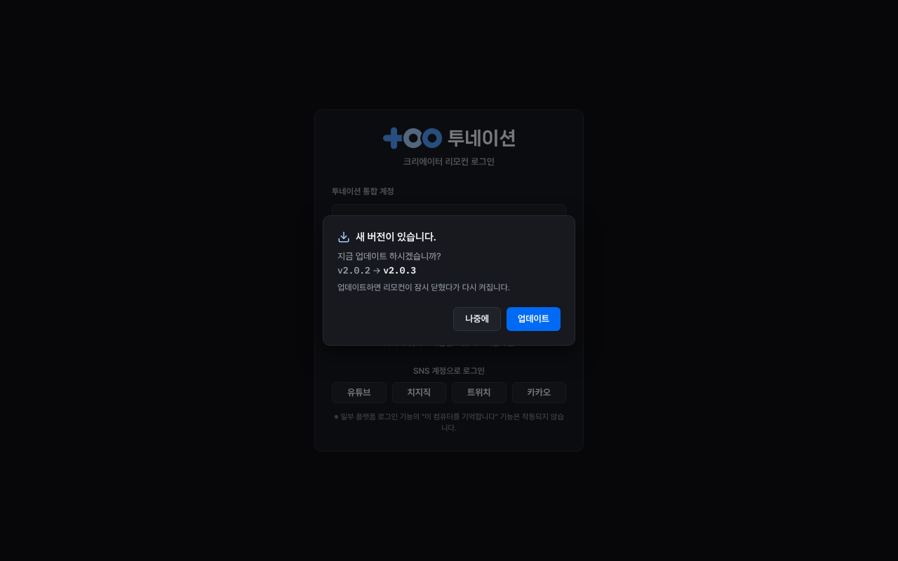
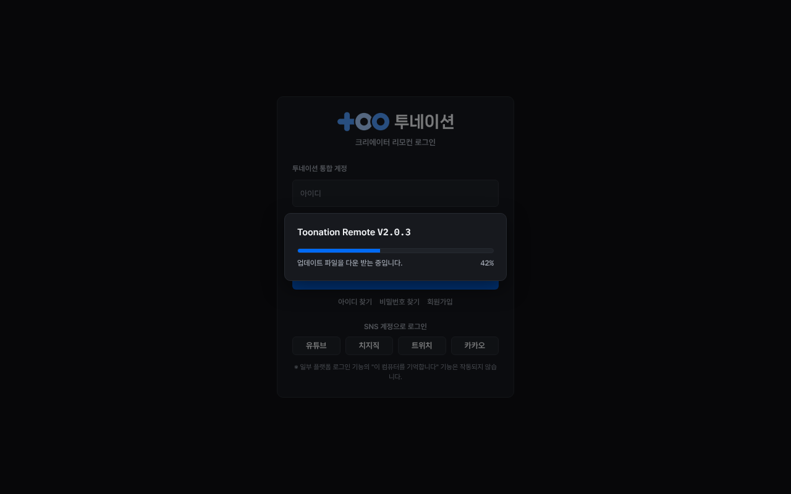
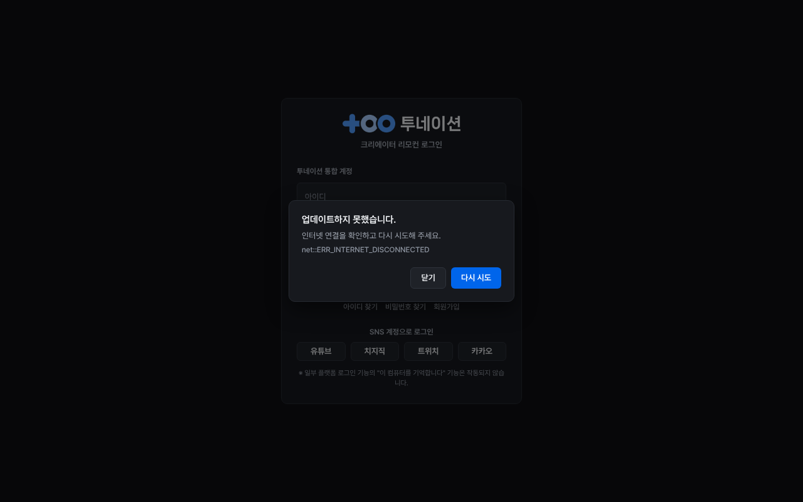

# 설치형 자동 업데이트

- 작업일: 2026-11-25 · 버전 2.0.2부터
- 도구: electron-updater (Electron 표준)
- 업데이트 서버: 이 저장소의 GitHub 릴리스 (`caprisontoon/remote01`)

## 동작

1. 설치된 리모컨을 실행하면 3초 뒤 GitHub 릴리스의 `latest.yml`을 확인한다.
2. 지금 버전보다 새 버전이 있으면 알림창을 띄운다. 로그인·스플래시 화면 위에도 뜬다.
   - "새 버전이 있습니다. 지금 업데이트 하시겠습니까?"
   - 현재 버전과 새 버전을 함께 보여 준다 (`v2.0.2 → v2.0.3`).
   - 버튼은 [나중에] / [업데이트] 두 개다.
3. **[업데이트]**를 누르면 설치 파일을 받으면서 진행 막대를 보여 준다. 문구는 기획서 p35를 따른다("업데이트 파일을 다운 받는 중입니다.").
   - 다 받으면 리모컨이 닫히고 설치가 조용히 진행된 뒤 다시 켜진다.
   - 받지 못하면 "업데이트하지 못했습니다" 창에서 [다시 시도] / [닫기]를 고른다.
4. **[나중에]**를 누르면 이번 실행 동안 다시 묻지 않는다. 다음에 실행할 때 다시 묻는다.

- 인터넷이 없거나 확인에 실패하면 아무것도 띄우지 않고 그냥 실행된다.
- 개발 실행(`npm run dev:desktop`)과 웹 리모컨에서는 확인하지 않는다.

## 새 버전 내는 법

1. `package.json`의 `version`을 올린다 (예: 2.0.2 → 2.0.3).
2. 작업 브랜치나 main에 푸시한다.
3. `.github/workflows/release.yml`이 다음을 자동으로 한다.
   - Windows 설치 파일을 만든다.
   - 릴리스 `v<버전>`에 4개를 올린다.

| 올리는 파일 | 용도 |
|---|---|
| `TOONA-Setup-<버전>.exe` | 설치 파일 (자동 업데이트가 받는 파일) |
| `latest.yml` | 새 버전 정보. 리모컨이 이 파일을 보고 업데이트 여부를 판단한다 |
| `TOONA-Setup-<버전>.exe.blockmap` | 바뀐 부분만 받는 차등 다운로드용 |
| `TOONA-Setup.exe` | 수동 설치용 고정 링크 (`releases/latest/download/TOONA-Setup.exe`) |

- 릴리스가 "Latest"로 표시되어야 자동 업데이트 대상이 된다. 워크플로가 `--latest`로 만든다.
- 앱 버전은 `package.json` 하나에서 정한다.
  - 화면의 버전 표시(`APP_VERSION`)와 업데이트 비교가 모두 이 값을 쓴다.
  - `vite.config.ts`가 빌드할 때 이 값을 넣는다.

## 주의

- **처음 한 번은 직접 설치해야 한다.** 자동 업데이트는 2.0.2부터 들어 있다. 이미 2.0.0이나 2.0.1을 설치한 PC는 2.0.2를 [설치 파일 받기](https://github.com/caprisontoon/remote01/releases/latest/download/TOONA-Setup.exe)로 한 번 설치해야 한다. 그다음 버전(2.0.3~)부터 자동으로 묻는다.
- **코드 서명 전이다.**
  - 업데이트 파일도 서명이 없어서, 스마트 앱 컨트롤이 켜진 PC에서는 업데이트 설치가 막힌다. 그런 PC에는 애초에 설치도 되지 않는다.
  - 서명을 붙이면 `package.json` `build.win`에 서명 설정을 추가한다. 서명된 앱은 electron-updater가 업데이트 파일의 서명자도 확인한다.
- 설치 방식은 사용자별 설치(관리자 권한 없음)라서 업데이트할 때 권한을 묻지 않는다.

## 코드

- `electron/updater.ts`
  - 확인, 받기, 설치를 한다.
  - 상태는 `idle` / `available` / `downloading` / `downloaded` / `error`이고 창에 보낸다.
- `electron/preload.ts`: `window.toona.updates` (`status`, `download`, `dismiss`, `onStatus`)
- `src/shell/UpdatePrompt.tsx`: 알림창. 메인 창에만 뜬다(위젯 독립창에는 안 뜬다).
- `package.json` `build.publish`: GitHub 릴리스를 업데이트 서버로 지정한다. 설치 파일 안에 `app-update.yml`로 들어간다.

## 화면

| 새 버전 알림 | 받는 중 | 실패 |
|---|---|---|
|  |  |  |

## 검증

- `npm run typecheck`, `npm test`(110개), 설치형 빌드 통과. electron-updater가 메인 프로세스에 함께 묶이는 것을 확인했다.
- Electron(개발 실행)에서 알림창, 진행 막대, 오류 화면을 확인했다.
  - 로그인 화면 위에도 뜬다.
  - [업데이트]를 누르면 메인 프로세스로 요청이 간다.
  - [닫기]를 누르면 사라진다.
  - 개발 실행에서는 실제 확인을 하지 않아서, 상태는 메인 프로세스에서 보내 흉내 냈다.
- 실제 업데이트(받기 → 설치 → 재실행)는 Windows에서만 확인할 수 있다. 2.0.2를 설치한 뒤 2.0.3을 내면 확인된다.
